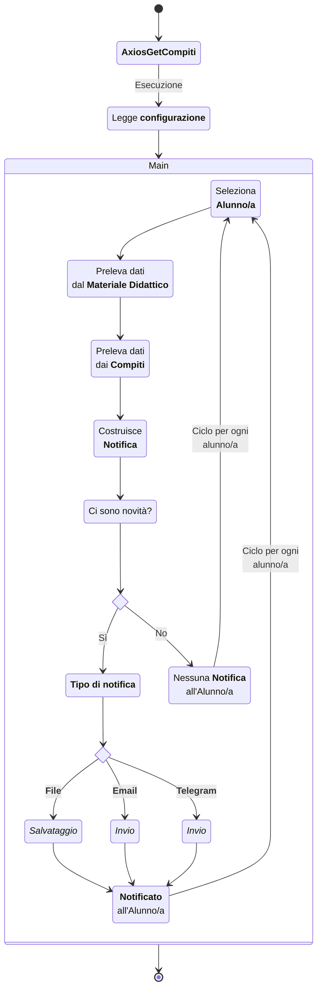
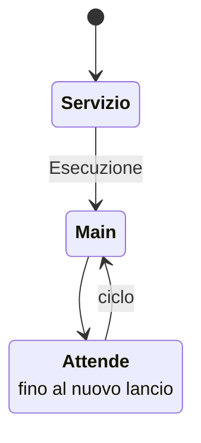

# Funzionamento

Axios-Get è un progetto open source (sviluppato in Python) pensato per scaricare automaticamente i compiti assegnati sul registro elettronico Axios Famiglia e notificarli direttamente ai figli, superando le barriere burocratiche o legali che spesso impediscono agli studenti di avere un proprio account sul registro elettronico alunni.

Lo script è totalmente cross-platform (compatibile con Linux, MacOS e Windows) e può essere eseguito principalmente in due modi:

⚙️ OneShot (Esecuzione Manuale)

Permette di verificare e scaricare i compiti al momento.

* Su Windows: Basta un doppio clic sul file eseguibile (AxiosGetCompiti.exe) scaricato dalle release.

* Su Linux / MacOS: Si lancia direttamente da terminale con il comando python AxiosGetCompiti.py.

⚙️ Service (Integrazione in uno Schedulatore)

Per evitare di dover cliccare ogni giorno, il tool è progettato per integrarsi perfettamente con i sistemi di automazione per controllare il registro a orari prestabiliti:

* Linux (Systemd): Il repository fornisce già i file di configurazione pronti (.service di tipo oneshot e relativo .timer) per controllare il registro, ad esempio, nella fascia oraria pomeridiana dalle 14:00 alle 18:30.

* Windows: È possibile configurare l'esecuzione automatica programmata tramite l'Utilità di pianificazione (taskschd.msc) di sistema.

## OneShot

## Service

